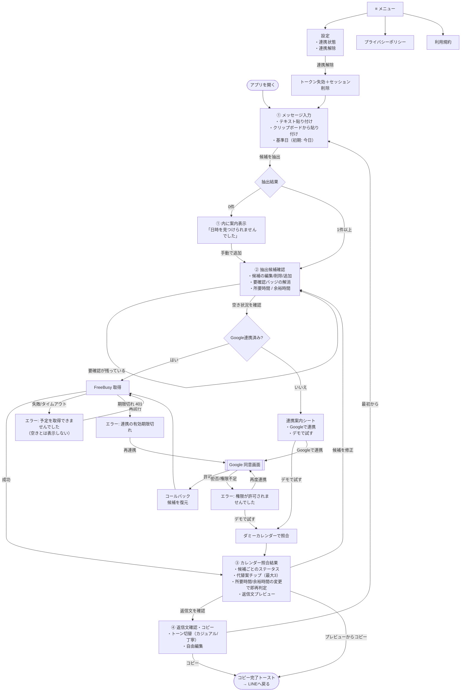

# 02. 画面遷移図

> GitHub 上でこのファイルを開くと、下の図（Mermaid）が自動で図として表示されます。

## 1. 基本方針

- **1 ページ内のステップ式（ウィザード）**にして画面の読み込みを減らす。URL は `/` のみ（ブラウザの戻るボタンでステップを戻れるよう `?step=` を同期）。
- 最短操作: **貼り付け → [候補を抽出] → [空き状況を確認] → [返信文をコピー]** の 4 タップ。
- 曖昧な候補がある場合のみ、ステップ 2 で確認操作が増える。
- 照合結果画面（3）の下部に返信文のプレビューを表示し、そのままコピーもできる（4 を開かずに完了できる）。

## 2. 画面遷移図



## 3. 各画面のワイヤーフレーム（スマートフォン 360px 基準）

### ① メッセージ入力
```
┌──────────────────────────┐
│ KYRE Schedule        ≡  │  ← ロゴは細めのセリフ体＋ゴールド
│ ● ○ ○ ○                  │  ← ステップ表示
│                          │
│ 届いた日程のメッセージを  │
│ 貼り付けてください        │
│ ┌──────────────────────┐ │
│ │ 来週どこか飲みに行こう！│ │
│ │ 10/20(火)か21(水)の…   │ │
│ └──────────────────────┘ │
│  [📋 クリップボードから]   │
│  基準日: 10/13(火) 変更 › │
│                          │
│ ╔══════════════════════╗ │
│ ║     候補を抽出する      ║ │  ← 主ボタン（画面下部固定）
│ ╚══════════════════════╝ │
│ 本文は端末内で処理され、   │
│ サーバーに送信されません。 │
└──────────────────────────┘
```

### ② 抽出候補確認
```
┌──────────────────────────┐
│ ‹ 戻る    ○ ● ○ ○        │
│ 2件の候補が見つかりました │
│ ┌──────────────────────┐ │
│ │ 10/20(火) 19:00〜   ✎ ✕│ │
│ └──────────────────────┘ │
│ ┌──────────────────────┐ │
│ │ ⚠要確認 10/21(水) 7:00? │ │
│ │ 午前 ○  午後 ●(19:00)  │ │
│ └──────────────────────┘ │
│ ＋ 候補を追加             │
│ 所要時間 [30][60][●90][120][180] │
│ 前後の余裕 [0][●15][30][60] │
│ 時間帯 [●24時間][9〜18][18〜24]│
│   [0:00 ▾] 〜 [24:00 ▾]     │
│ ╔══════════════════════╗ │
│ ║   空き状況を確認する    ║ │  ← 要確認が残ると無効
│ ╚══════════════════════╝ │
└──────────────────────────┘
```

### ③ カレンダー照合結果
```
┌──────────────────────────┐
│ ‹ 戻る    ○ ○ ● ○        │
│ ┌──────────────────────┐ │
│ │ ◎ 10/20(火) 19:00-20:30│ │  ← ゴールドの細枠
│ │   参加できます          │ │
│ └──────────────────────┘ │
│ ┌──────────────────────┐ │
│ │ × 10/21(水) 19:00      │ │
│ │   予定があります        │ │
│ │   代替案 [20:30][17:30]│ │  ← タップで返信に反映
│ └──────────────────────┘ │
│ 90分・余裕15分  変更 ›    │
│ ─ 返信文プレビュー ─      │
│ 誘ってくれてありがとう！… │
│ ╔══════════════════════╗ │
│ ║   返信文をコピー        ║ │
│ ╚══════════════════════╝ │
│      返信文を編集する ›    │
└──────────────────────────┘
```

### ④ 返信文確認・コピー
```
┌──────────────────────────┐
│ ‹ 戻る    ○ ○ ○ ●        │
│ トーン [●カジュアル][丁寧] │
│ ┌──────────────────────┐ │
│ │ 誘ってくれてありがとう！│ │
│ │ 10/20(火) 19:00〜なら  │ │
│ │ 行けるよ！…            │ │  ← 自由編集可
│ └──────────────────────┘ │
│ ╔══════════════════════╗ │
│ ║     コピーする          ║ │
│ ╚══════════════════════╝ │
│       最初からやり直す      │
└──────────────────────────┘
```

## 4. デザイン指針

| 項目 | 指針 |
|---|---|
| 基調色 | 背景 `#FFFFFF` / サブ背景 `#FAF8F4`（わずかに温かい白） |
| 文字色 | `#1A1A1A`（本文）/ `#6B6B6B`（補足） |
| アクセント | 控えめなゴールド `#B8975A`（ボタン枠・選択状態・参加可能）。面で多用せず線と小要素に限定 |
| 主ボタン | 黒 `#1A1A1A` 背景＋白文字、またはゴールド細線。角丸 12px |
| 書体 | 本文: Noto Sans JP / 見出し・ロゴ: Noto Serif JP（Google Fonts を自己ホストして外部通信を避ける） |
| 余白 | 16px 基準、セクション間 24〜32px |
| 動き | 150〜200ms のフェードとスライドのみ。`prefers-reduced-motion` で無効化 |
| 操作 | 主ボタンは画面下部固定（親指の届く位置）、タップ領域 44px 以上 |
| コントラスト | ゴールド文字は小さく使わない（白背景で AA を満たさないため）。ゴールドは装飾・枠線中心 |

## 5. OAuth リダイレクト時の状態保持

Google 連携でページを離れると入力状態が消えるため、**抽出済み候補と設定のみ**（メッセージ本文は含めない）を `sessionStorage` に一時保存し、戻ってきたら復元して即座に照合する。復元後は削除する。
