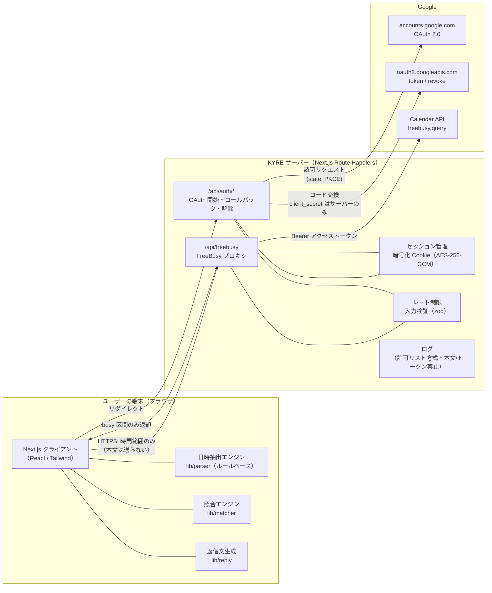
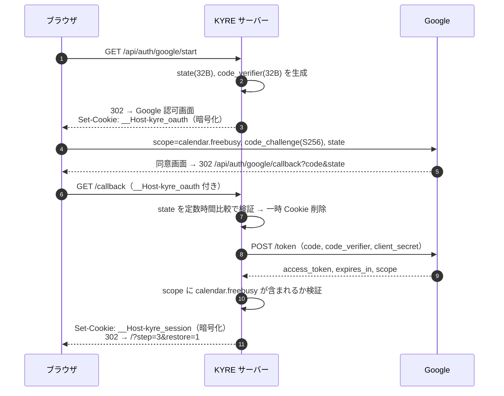

# 03. システム構成図

## 1. 全体像

## 2. 技術スタック

| 層 | 採用技術 | 理由 |
|---|---|---|
| フレームワーク | Next.js（App Router）＋ TypeScript（strict） | 画面とサーバー API を 1 リポジトリで管理 |
| スタイル | Tailwind CSS | モバイル優先の迅速な UI 実装 |
| 日時計算 | `date-fns` ＋ `@date-fns/tz` | タイムゾーンを明示した日時計算。軽量 |
| 入力検証 | `zod` | API の入出力スキーマ検証 |
| セッション暗号化 | `jose`（JWE: dir + A256GCM） | 実績あるライブラリで暗号化 Cookie を実装 |
| Google 連携 | `fetch` で REST API を直接呼ぶ | `googleapis` パッケージは巨大なため不使用。必要なのは 3 エンドポイントのみ |
| 単体テスト | Vitest | 高速、TypeScript ネイティブ |
| E2E テスト | Playwright | モバイル端末エミュレーション |
| API モック | MSW（Mock Service Worker） | テスト時に Google API を模擬 |
| データベース | **なし** | 保存すべきユーザーデータがないため |
| ホスティング（候補） | Vercel | Next.js と相性が良い。※デプロイ時に改めて承認をいただきます（後述） |

## 3. セッション設計（データベースなしで「サーバー側セッション」を実現）

| 項目 | 設計 |
|---|---|
| 方式 | 暗号化 Cookie（中身はサーバーの秘密鍵でしか復号できない。ブラウザの JS からは読めず、読めても暗号文のみ） |
| Cookie 名 | `__Host-kyre_session`（`__Host-` 接頭辞で Secure・Path=/・ドメイン固定を強制） |
| 属性 | `HttpOnly; Secure; SameSite=Lax; Path=/` |
| 中身 | Google アクセストークン、有効期限、付与されたスコープ、セッション ID（乱数） |
| 有効期限 | アクセストークンと同じ（約 1 時間）。期限切れ後は再連携 |
| リフレッシュトークン | **取得しない**（`access_type=online`）。漏洩時の被害を 1 時間に限定するため（※承認事項） |
| 鍵 | `SESSION_SECRET`（32 バイト乱数、環境変数）。ローテーション時は旧鍵での復号も一定期間許可 |
| OAuth 一時 Cookie | `__Host-kyre_oauth`（state・code_verifier を暗号化して保持、10 分で失効、コールバックで即削除） |

> **補足（初心者向け）**: 「サーバー側セッション」は通常データベースに保存しますが、本アプリは保存対象が「1 時間で切れるトークン 1 つ」だけなので、暗号化してブラウザに預ける方式にしています。中身はサーバーしか読めないため、Google の認証情報がブラウザの JavaScript に漏れることはありません。

## 4. OAuth 設計

| 項目 | 設定 |
|---|---|
| スコープ | `https://www.googleapis.com/auth/calendar.freebusy` のみ（予定の件名・場所などは取得不可） |
| メール等の個人情報 | 取得しない（`openid` / `email` を要求しない）※承認事項 |
| PKCE | S256 必須 |
| state | 32 バイト乱数、一時 Cookie と照合、1 回限り |
| redirect_uri | 固定値（環境変数）。完全一致で Google Console に登録 |
| 部分同意 | Google はスコープごとにチェックボックスを外せるため、付与スコープを必ず検証し、不足時は専用エラー表示 |
| 連携解除 | `POST /api/auth/disconnect` → `https://oauth2.googleapis.com/revoke` でトークン失効 → Cookie 削除 |

## 5. API 一覧（サーバー）

| メソッド | パス | 役割 | 入力 | 出力 |
|---|---|---|---|---|
| GET | `/api/auth/google/start` | OAuth 開始 | なし | 302 |
| GET | `/api/auth/google/callback` | OAuth コールバック | `code`, `state` | 302 |
| POST | `/api/auth/disconnect` | 連携解除 | なし | 204 |
| GET | `/api/session` | 連携状態確認 | なし | `{ connected: boolean, expiresAt }` |
| POST | `/api/freebusy` | 空き状況取得 | `{ ranges: [{ timeMin, timeMax }] }`（最大 10、各 1 日以内） | `{ status: "ok", busy: [{start,end}] }` または `{ status: "error", code }` |

- POST API は CSRF 対策として Origin ヘッダー検証＋`Content-Type: application/json` 必須＋独自ヘッダー `X-KYRE-Request: 1` 必須。
- `/api/freebusy` は Google の busy 区間のみを返す（Google からも busy 時刻以外は返らない）。

## 6. レート制限

| 対象 | 制限（案） |
|---|---|
| `/api/freebusy` | セッションあたり 30 回 / 10 分、IP あたり 60 回 / 10 分 |
| `/api/auth/*` | IP あたり 20 回 / 10 分 |

- MVP はサーバーのメモリ内カウンターで実装（データベース不要）。サーバーレス環境ではインスタンスごとに数えるため厳密ではない。
- 本格公開時は外部ストア（例: Upstash Redis）を検討 — **外部サービス利用のため、その際は承認をいただきます**。

## 7. ホスティングに関する注意（承認事項）

- Vercel の無料プラン（Hobby）は**非商用利用に限定**されています。KYRE を事業として運営する場合は有料プラン（Pro）が必要になる可能性があります。デプロイ前に利用目的を確認のうえ、改めて承認をいただきます。
- 代替: Cloudflare、Google Cloud Run など。いずれもデプロイ・課金設定はご承認後に行います。

## 8. 環境変数

| 名前 | 内容 | 公開可否 |
|---|---|---|
| `GOOGLE_CLIENT_ID` | OAuth クライアント ID | サーバーのみ（`NEXT_PUBLIC_` を付けない） |
| `GOOGLE_CLIENT_SECRET` | OAuth クライアントシークレット | **秘密** |
| `GOOGLE_REDIRECT_URI` | コールバック URL | サーバーのみ |
| `SESSION_SECRET` | セッション暗号鍵（32 バイト乱数） | **秘密** |
| `APP_ORIGIN` | 例: `https://schedule.kyre.example` | サーバーのみ |
| `SESSION_SECRET_PREVIOUS` | 鍵ローテーション時の旧鍵（任意） | **秘密** |
| `GOOGLE_ENDPOINT_OVERRIDE` | E2E 用の偽 Google サーバー。`APP_ORIGIN` が localhost のときだけ有効（本番では設定不可） | サーバーのみ |

- デモ（ダミーカレンダー）はブラウザ内で動くため、サーバー側のモード切替は不要（v0.2 で `CALENDAR_MODE` を廃止）。
- Google 連携の設定がない場合はデモのみ利用可能になる。

- `.env.local` は Git に含めない（`.gitignore`）。`.env.example` に名前だけ記載。
- zod で検証し、不足・形式不正なら Google 連携を無効化（デモのみ）し、不正な**項目名だけ**をログに出す（値は出さない）。
