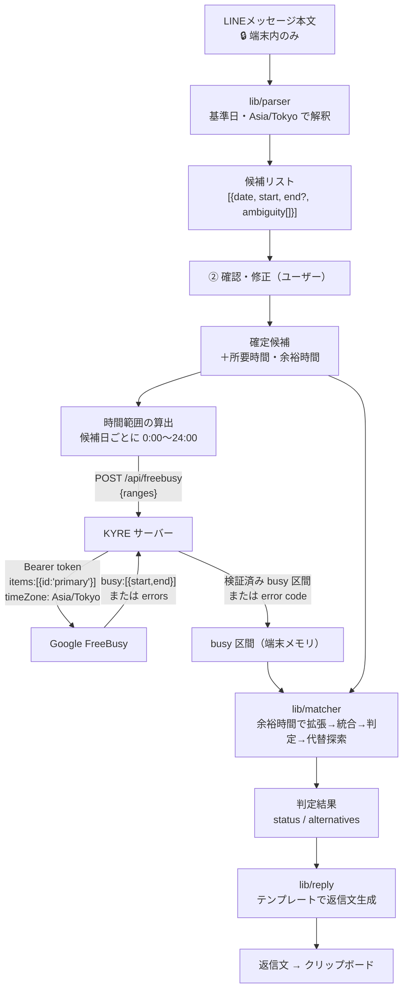

# 04. データフロー

## 1. 原則

1. **メッセージ本文は端末から出ない**: 日時抽出・返信文生成はすべてブラウザ内で実行。
2. **サーバーが受け取るのは「時間範囲」だけ**: 例 `2026-10-20T00:00:00+09:00〜2026-10-21T00:00:00+09:00`。
3. **Google から受け取るのは「busy の時刻」だけ**: FreeBusy API は予定の件名・場所・参加者を返さない。
4. **何も保存しない**: データベースなし。サーバーに残るのはメタデータのみのログ。

## 2. 全体データフロー



## 3. データ項目と保存場所

| データ | 発生場所 | 送信先 | 保存場所・期間 | 機微度 |
|---|---|---|---|---|
| メッセージ本文 | ユーザー入力 | **どこにも送らない** | ブラウザのメモリのみ（画面を閉じれば消える） | 高 |
| 確定候補（日時のみ） | parser / ユーザー編集 | なし | メモリ。OAuth 往復時のみ `sessionStorage`（復元後削除） | 中 |
| 時間範囲 | 確定候補から算出 | KYRE サーバー → Google | サーバーで保存しない | 低〜中 |
| busy 区間 | Google | KYRE サーバー → ブラウザ | ブラウザのメモリのみ | 中 |
| アクセストークン | Google | KYRE サーバーのみ | 暗号化 Cookie（約 1 時間） | **最高** |
| OAuth state / code_verifier | サーバー | Google（challenge のみ） | 暗号化一時 Cookie（10 分、使用後削除） | 高 |
| client_secret | 環境変数 | Google のみ | ホスティングの秘密情報管理 | **最高** |
| 返信文 | reply | クリップボード | ブラウザのメモリのみ | 高 |
| サーバーログ | サーバー | ホスティングのログ基盤 | ホスティングの保持期間 | 低（下記の許可項目のみ） |

## 4. ログに記録してよい項目（許可リスト）

| 記録する | 記録しない（禁止） |
|---|---|
| リクエスト ID、ルート名、HTTP ステータス、処理時間 | メッセージ本文、返信文 |
| エラーコード（例: `GOOGLE_401`, `RATE_LIMITED`） | アクセストークン、認可コード、state、code_verifier |
| 照合した範囲の**件数**（日時そのものは記録しない） | busy 区間、候補日時 |
| Google API の HTTP ステータスとエラー理由コード | Google のエラーレスポンス本文全体、Cookie、Authorization ヘッダー |

- ロガーは「許可したキーだけ出力する」関数を自作し、`console.log` の直接使用を Lint で禁止する。
- 例外オブジェクトはスタックトレースのみ記録（メッセージにトークンが含まれる可能性があるライブラリを使わない）。

## 5. FreeBusy リクエスト / レスポンス例

リクエスト（サーバー → Google）:
```json
{
  "timeMin": "2026-10-20T00:00:00+09:00",
  "timeMax": "2026-10-22T00:00:00+09:00",
  "timeZone": "Asia/Tokyo",
  "items": [{ "id": "primary" }]
}
```

レスポンス（Google → サーバー）:
```json
{
  "calendars": {
    "primary": {
      "busy": [
        { "start": "2026-10-21T09:00:00Z", "end": "2026-10-21T10:30:00Z" }
      ]
    }
  }
}
```

サーバーでの検証:
- `calendars.primary` が存在し、`errors` が**ない**こと
- `busy` の各要素が ISO 8601 で `start < end`
- 上記を満たさない場合は `{ status: "error", code: "FETCH_FAILED" }` を返す（**空配列で返さない** ＝「空き」と誤判定させない）

## 6. 照合の計算例

条件: 候補 10/21(水) 19:00、所要 90 分、余裕 15 分。busy: 18:00〜19:30（JST）

1. busy 拡張: 17:45〜19:45
2. 候補 19:00〜20:30 → 重なる → 不可
3. 代替探索（+15, −15, +30, −30, …）:
   - +15 (19:15) 重なる、−15 (18:45) 重なる、… +45 (19:45〜21:15) **可**
   - −… 16:15〜17:45 は 17:45 で接するだけ（半開区間）なので **可**（−165 分）
   - +60 (20:00) **可**、+75 (20:15) **可** …
4. 近い順で採用: **19:45, 20:00, 20:15**（3 件で打ち切り）
